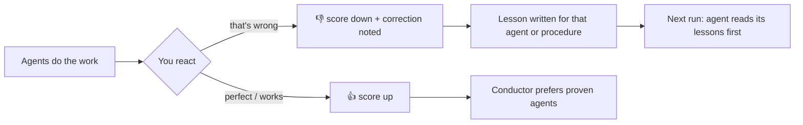

<p align="center">
  
</p>

<h1 align="center">Legion</h1>

<p align="center">
  <b>An AI team that splits the work, proves the result, gets checked by other AIs — and learns how you work.</b><br>
  80 agents · 300 procedures · 10 playbooks · for <b>Claude Code</b>, <b>Codex</b>, <b>Gemini CLI</b> and <b>Cursor</b> · Windows, macOS, Linux
</p>

<p align="center">
  <a href="README.pt-BR.md">🇧🇷 Leia em português</a> ·
  <a href="docs/CATALOG.md">Full catalogue</a> ·
  <a href="#install">Install</a>
</p>

---

## What is Legion?

Legion turns your coding assistant into a coordinated team. Ask for something big — *"build a signup page with validation and deploy it"* — and Legion's conductor splits it into subtasks, runs the right specialists **in parallel**, merges and verifies the work, and reports what it cost.

What makes it different:

| | |
|---|---|
| ⚖️ **AI Council** | Claude, Codex and Gemini **review each other's work**, read-only. One writes, the others challenge; the author fixes or rejects each finding with a reason. |
| 📘 **Learns from outcomes** | Say "perfect" or "that's wrong" and Legion scores the agents that did the work and writes **lessons** they read next time. It gets better *for you*. |
| 📡 **Mission Control** | A live local dashboard: agents working right now, token cost per agent, team scoreboard, lessons, council verdicts, memory. |
| ✅ **No proof, not done** | Every task ends with an evidence table — the command, test or file that proves each requirement — plus a cost report. |
| 🗺️ **Playbooks** | End-to-end recipes: SaaS MVP, IoT product, mobile app, AI assistant with RAG, security hardening and more. |
| 🧠 **Memory** | Remembers your language, stack and style (`"from now on use pnpm"`) — stored only on your computer. |
| 🪶 **Lean** | ~9k tokens of always-on context; cheap models for simple agents; solo / lite / full modes. |

## Install

**Windows, macOS or Linux** — in a terminal (PowerShell, Terminal, bash):

```bash
git clone https://github.com/Gleysonp-Dev/legion-ai.git
node legion-ai/install.js
```

The installer detects **Claude Code, Codex, Gemini CLI and Cursor** and sets up each one it finds. Restart them afterwards. Needs Node.js 18+ and git.

<details>
<summary>Other ways to install</summary>

**One line (macOS / Linux)**
```bash
curl -fsSL https://raw.githubusercontent.com/Gleysonp-Dev/legion-ai/main/install.sh | sh
```

**One line (Windows PowerShell)**
```powershell
irm https://raw.githubusercontent.com/Gleysonp-Dev/legion-ai/main/install.ps1 | iex
```

**Claude Code only, as a plugin**
```bash
claude plugin marketplace add Gleysonp-Dev/legion-ai
claude plugin install legion@legion-ai
```

**Choose tools**: `node install.js --claude --codex --gemini --cursor` (any combination)
**Preview**: `node install.js --dry-run`
</details>

**Update:** `git -C legion-ai pull && node legion-ai/install.js`
**Uninstall:** `node legion-ai/install.js --uninstall` (add `--purge` to also delete memory and lessons)

| Tool | Agents | Skills | Memory & learning | Live dashboard |
|---|---|---|---|---|
| Claude Code | plugin subagents | plugin skills | automatic (hooks) | full activity + cost |
| Codex | `~/.codex/agents` | `~/.agents/skills` | via `AGENTS.md` instructions | council, lessons, cost |
| Gemini CLI | `~/.gemini/agents` | `~/.agents/skills` | via `GEMINI.md` instructions | council, lessons |
| Cursor | `~/.cursor/agents` | `~/.agents/skills` | automatic (hooks) | activity |

## Use it

| You want to… | Claude Code | Codex / Gemini CLI / Cursor |
|---|---|---|
| Put the team on a big task | `/legion:legion full build a SaaS dashboard` — or *"use legion to…"* | `$legion full …` (Codex) or *"use the legion skill to…"* |
| Keep it cheap | `/legion:legion lite …` | same, with `lite` |
| Run a whole project | `/legion:legion-playbooks` → *"SaaS MVP for dog walkers"* | *"use legion-playbooks: IoT product"* |
| Get other AIs to review | `/legion:legion-council` or `node ~/.legion/bin/council.js review` | same command, with `--host codex` / `gemini` / `cursor` |
| Call one specialist | *"use the debugger agent to…"* | Codex: *"spawn debugger"* · Gemini: `@debugger` |
| Watch everything live | `node ~/.legion/bin/legion.js dashboard` | same |
| See what it cost | `node ~/.legion/bin/legion.js report` | `report --codex` for Codex |
| Find the right agent | `/legion:legion-help` | `$legion-help` / *"legion-help"* |

## ⚖️ The AI Council

Different AI models make different mistakes. The council lets them catch each other's:

```bash
cd your-project
node ~/.legion/bin/council.js status --host claude      # who can review (Codex, Gemini…)
node ~/.legion/bin/council.js review --host claude --focus "signup must validate email"
node ~/.legion/bin/council.js plan docs/plan.md         # challenge a plan before building
node ~/.legion/bin/council.js ask "Postgres or DynamoDB here?"
```

- Reviewers run **read-only** (Codex `--sandbox read-only`, Claude limited to Read/Grep/Glob, Gemini headless) and never review their own work.
- They answer in a strict format; Legion merges duplicates, ranks by severity and computes a consensus (approve / changes / reject).
- The author has the final word: each finding is **fixed or rejected with a reason**. Reports are saved in `~/.legion/council/`.
- Uses the AI tools you already have installed and logged in — each review spends tokens on that tool.

Example verdict (real run, Claude reviewing a change made by Codex):

| id | severity | where | issue | raised by |
|---|---|---|---|---|
| F1 | blocker | app.js:2 | `signup(email)` saves input without any validation | claude |
| F2 | major | app.js:2 | email not normalised (trim/lowercase) → duplicate accounts | claude |

## 📘 Legion learns from outcomes



- **Scoreboard:** every agent and pack gets 👍/👎 from your reactions right after its work (`legion.js scores`). Works in English, Portuguese and Spanish.
- **Lessons:** after a correction, the conductor writes one actionable lesson (`~/.legion/lessons/ui-engineer.md`: *"Check the layout at 360px before reporting done"*). That agent reads it on every future run.
- **Team record in memory:** the conductor sees which agents are proven with you and which need closer checking.
- Scores are approximate (a reaction applies to everything used in that turn); correct them with `memory.js feedback up|down --target <name>`.

## 📡 Mission Control

```bash
node ~/.legion/bin/legion.js dashboard              # macOS / Linux / Git Bash
node $HOME\.legion\bin\legion.js dashboard        # Windows PowerShell
npm run dashboard                                   # from the legion-ai folder, any OS
```

<p align="center"></p>

A local page (127.0.0.1 only, nothing leaves your computer) that updates live: agents working right now, activity feed, token cost per agent, team scoreboard, council verdicts, lessons and memory.

## 🗺️ Playbooks

| Playbook | What you get |
|---|---|
| `saas-mvp` | auth, core feature, billing (test mode), CI/CD, monitoring |
| `landing-page-launch` | copy, fast page, lead capture, analytics, domain |
| `iot-product` | firmware, MQTT, time-series storage, live dashboard, alerts, OTA |
| `mobile-app` | app with offline sync, push, analytics, store release |
| `api-service` | OpenAPI spec, tested endpoints, docs, deploy, load test |
| `ai-assistant-rag` | document Q&A with citations, evals, guardrails, cost control |
| `security-hardening` | threat model, audit, fixes, council review, re-test |
| `data-dashboard` | metric definitions, clean pipelines, trusted dashboard |
| `legacy-upgrade` | safety-net tests, step-by-step upgrade, rollback |
| `open-source-launch` | clean history, README, CI, licence, launch posts |

Each lists who works in which wave, what each step delivers and **what proves it is done**.

## How a run works

1. **Memory** — your preferences, team record and lessons are loaded.
2. **Mode** — *solo* (no agents), *lite* (≤3) or *full* (whole team): the cheapest that does the job well.
3. **Plan** — dispatch table: subtask, agent, dependencies, wave, how it will be proven.
4. **Dispatch** — independent subtasks in parallel; dependent ones wait.
5. **Integrate & prove** — QA runs real checks; the council reviews important work.
6. **Report** — result, evidence table, cost.
7. **Learn** — preferences, scores and lessons are updated.

## The 10 teams (80 agents)

| Team | Agents |
|---|---|
| **Command Center** | conductor, task-splitter, integrator, chief-reviewer, memory-curator, context-scout, qa-gatekeeper, risk-assessor |
| **Architecture & Backend** | software-architect, backend-engineer, api-designer, database-architect, microservices-engineer, integration-engineer, realtime-engineer, auth-specialist |
| **Frontend, Mobile & Devices** | frontend-architect, ui-engineer, react-specialist, css-stylist, mobile-engineer, accessibility-expert, web-performance-tuner, iot-engineer |
| **Data & AI** | data-engineer, data-analyst, ml-engineer, llm-engineer, prompt-engineer, rag-specialist, data-visualizer, analytics-engineer |
| **Infrastructure & DevOps** | devops-engineer, cloud-architect, ci-cd-engineer, container-specialist, sre-engineer, observability-engineer, cost-optimizer, release-manager |
| **Quality Engineering** | test-architect, unit-tester, e2e-tester, debugger, code-reviewer, refactoring-expert, performance-engineer, legacy-modernizer |
| **Security & Compliance** | security-auditor, appsec-engineer, threat-modeler, secrets-guardian, dependency-auditor, privacy-engineer, compliance-analyst, cloud-security-engineer |
| **Product & Design** | product-manager, ux-researcher, ux-designer, ui-designer, requirements-analyst, design-system-builder, growth-strategist, roadmap-planner |
| **Content, Docs & Marketing** | technical-writer, documentation-engineer, copywriter, seo-specialist, content-strategist, translator, social-media-manager, presentation-designer |
| **Business, Research & Ops** | business-analyst, financial-analyst, market-researcher, research-analyst, project-manager, operations-automator, legal-researcher, customer-success-advisor |

Simple agents run on Haiku, deep-reasoning ones (conductor, architect, chief reviewer, debugger, security auditor, threat modeler) on Opus, the rest on Sonnet. In Codex this maps to low/medium/high reasoning effort; Gemini CLI and Cursor use your current model. Force one model for all Claude Code subagents with `CLAUDE_CODE_SUBAGENT_MODEL`.

## 300 procedures in 30 packs

Planning · Architecture · Frontend · Backend · APIs · Databases · Testing · Debugging · Code quality · Security · DevOps · Cloud · Performance · Reliability · Data engineering · Data analysis · Machine learning · LLMs & agents · Mobile · Git · Documentation · UX/UI · Product · Marketing · Writing · Research · Business & finance · Productivity · Legal & privacy · IoT & embedded

Each pack is one skill (`legion-testing`, `legion-iot`…) with 10 procedures read on demand — only the short index stays in context. See the [full catalogue](docs/CATALOG.md).

## Memory, privacy and commands

> On Windows PowerShell, `~` is not expanded for `node`: use `$HOME\.legion\bin\legion.js` (or `npm run dashboard`, `npm run report`, `npm run scores` inside the legion-ai folder).

Everything lives in `~/.legion/` on your computer: `memory/` (preferences), `lessons/`, `council/` reports and `events.jsonl` (dashboard feed). Passwords, keys, tokens, card/account numbers, ID numbers and health data are never stored.

```bash
node ~/.legion/bin/legion.js show                 # what Legion knows about you
node ~/.legion/bin/legion.js scores               # team scoreboard
node ~/.legion/bin/legion.js lessons              # lessons learned
node ~/.legion/bin/legion.js report               # tokens this session, per agent
node ~/.legion/bin/legion.js add "Use TypeScript strict mode"
node ~/.legion/bin/legion.js forget r3
node ~/.legion/bin/memory.js reset --yes          # wipe memory
```

## Good to know

- **Context cost:** ~9k tokens per Claude Code session (measured with `claude plugin details legion`). Disable per project with `claude plugin disable legion@legion-ai --scope local`.
- **Council cost:** each reviewer is a full run of that AI tool on your account.
- **Codex parallelism:** raise the limit in `~/.codex/config.toml` → `[agents] max_concurrent_threads_per_session = 8`.
- **Your files are safe:** the installer never overwrites your own skills, agents, `AGENTS.md`/`GEMINI.md` content or Cursor hooks; uninstall removes only what Legion added.
- **Not professional advice:** legal, financial and compliance agents produce drafts and analysis.

## Project layout

```
src/agents/*.md            ← agent definitions (edit these)
src/skills/*.md            ← procedures, grouped into packs (edit these)
src/core-skills/           ← legion, legion-council, legion-playbooks, legion-memory, legion-help
scripts/build.js           → agents/ (Claude), codex/ gemini/ cursor/ agents, skills/, docs/CATALOG.md
scripts/memory.js          ← memory, learning, lessons, cost report, tool hooks
scripts/council.js         ← cross-AI review
scripts/mission-control.js ← live dashboard
install.js                 ← cross-platform installer for the 4 tools
```

## Contributing

Add or improve agents, procedures and playbooks in `src/`, run `npm run build && npm test`, open a pull request. See [CONTRIBUTING.md](CONTRIBUTING.md).

## License

[MIT](LICENSE) © 2026 Gleyson
