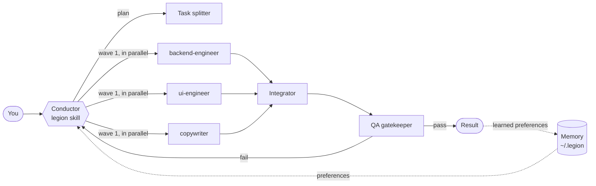

<p align="center">
  
</p>

<h1 align="center">Legion</h1>

<p align="center">
  <b>80 specialist AI agents that split the work · 300+ ready-made skills · a memory that learns how you work</b><br>
  For <b>Claude Code</b> and <b>Codex</b> · Windows, macOS and Linux · two commands to install
</p>

<p align="center">
  <a href="README.pt-BR.md">🇧🇷 Leia em português</a> ·
  <a href="docs/CATALOG.md">Full catalogue</a> ·
  <a href="#install">Install</a>
</p>

---

## What is Legion?

Legion turns your coding assistant into a coordinated team. Ask for something big — *"build a landing page with signup, tests and deploy"* — and Legion's conductor breaks it into subtasks, sends each one to the right specialist **in parallel**, merges the results, verifies them, and remembers what you liked for next time.

| | |
|---|---|
| **80 agents** | 10 teams of 8 specialists: command, backend, frontend & devices, data & AI, infrastructure, quality, security, product & design, content, business |
| **303 skills** | 30 categories × 10 skills + 3 core skills — step-by-step procedures with quality checklists |
| **Learning memory** | Detects your preferences ("always answer in Portuguese", "use pnpm") and applies them in every session — stored only on your computer |
| **Two tools** | Claude Code (plugin with agents, skills and hooks) and Codex (custom agents, skills and `AGENTS.md`) |
| **Zero dependencies** | Just Node.js 18+ and git |

## Install

**Windows, macOS or Linux** — in a terminal (PowerShell, Terminal, bash):

```bash
git clone https://github.com/Gleysonp-Dev/legion-ai.git
node legion-ai/install.js
```

That's it. The installer detects Claude Code and/or Codex and sets up both. Restart them afterwards.

<details>
<summary>Other ways to install</summary>

**One line (macOS / Linux)**
```bash
curl -fsSL https://raw.githubusercontent.com/Gleysonp-Dev/legion-ai/main/install.sh | sh
```

**One line (Windows PowerShell)**
```powershell
irm https://raw.githubusercontent.com/Gleysonp-Dev/legion-ai/main/install.ps1 | iex
```

**Claude Code only, as a plugin**
```bash
claude plugin marketplace add Gleysonp-Dev/legion-ai
claude plugin install legion@legion-ai
```

**Only one tool**: `node install.js --claude` or `node install.js --codex`
**Preview without changing anything**: `node install.js --dry-run`
</details>

**Update:** `git -C legion-ai pull && node legion-ai/install.js`
**Uninstall:** `node legion-ai/install.js --uninstall` (add `--purge` to also delete your memory)

## Use it

| You want to… | Claude Code | Codex |
|---|---|---|
| Run the whole team on a big task | `/legion:legion build a SaaS dashboard with auth and billing` — or just *"use legion to build…"* | `$legion build a SaaS dashboard with auth and billing` |
| Call one specialist | "use the **debugger** agent to find why login fails" | "spawn the **debugger** agent to find why login fails" |
| Use a skill | `/legion:security-review` or just describe the task | `$security-review` or just describe the task |
| Find the right agent/skill | `/legion:legion-help` | `$legion-help` |
| See what Legion learned about you | `/legion:legion-memory` | `$legion-memory` |

Skills also trigger automatically when your request matches their description. (If you installed with `--files` instead of the plugin, Claude Code skills have no `legion:` prefix: `/legion`, `/security-review`.)

## How it works



1. **Memory** — your saved preferences are loaded at the start of every session.
2. **Plan** — the conductor restates the goal and builds a dispatch table: subtask, agent, dependencies, wave, acceptance criteria.
3. **Dispatch** — independent subtasks run in parallel; dependent ones wait for their inputs.
4. **Integrate & verify** — the integrator merges, the QA gatekeeper runs real checks (tests, builds), the chief reviewer signs off on important work.
5. **Learn** — new preferences you expressed are saved for next time.

Small tasks stay small: Legion won't spin up a team for a one-line fix.

## The 10 teams

| Team | Agents |
|---|---|
| **Command Center** | conductor, task-splitter, integrator, chief-reviewer, memory-curator, context-scout, qa-gatekeeper, risk-assessor |
| **Architecture & Backend** | software-architect, backend-engineer, api-designer, database-architect, microservices-engineer, integration-engineer, realtime-engineer, auth-specialist |
| **Frontend, Mobile & Devices** | frontend-architect, ui-engineer, react-specialist, css-stylist, mobile-engineer, accessibility-expert, web-performance-tuner, iot-engineer |
| **Data & AI** | data-engineer, data-analyst, ml-engineer, llm-engineer, prompt-engineer, rag-specialist, data-visualizer, analytics-engineer |
| **Infrastructure & DevOps** | devops-engineer, cloud-architect, ci-cd-engineer, container-specialist, sre-engineer, observability-engineer, cost-optimizer, release-manager |
| **Quality Engineering** | test-architect, unit-tester, e2e-tester, debugger, code-reviewer, refactoring-expert, performance-engineer, legacy-modernizer |
| **Security & Compliance** | security-auditor, appsec-engineer, threat-modeler, secrets-guardian, dependency-auditor, privacy-engineer, compliance-analyst, cloud-security-engineer |
| **Product & Design** | product-manager, ux-researcher, ux-designer, ui-designer, requirements-analyst, design-system-builder, growth-strategist, roadmap-planner |
| **Content, Docs & Marketing** | technical-writer, documentation-engineer, copywriter, seo-specialist, content-strategist, translator, social-media-manager, presentation-designer |
| **Business, Research & Ops** | business-analyst, financial-analyst, market-researcher, research-analyst, project-manager, operations-automator, legal-researcher, customer-success-advisor |

## 300+ skills in 30 categories

Planning · Architecture · Frontend · Backend · APIs · Databases · Testing · Debugging · Code quality · Security · DevOps · Cloud · Performance · Reliability · Data engineering · Data analysis · Machine learning · LLMs & agents · Mobile · Git · Documentation · UX/UI · Product · Marketing · Writing · Research · Business & finance · Productivity · Legal & privacy · IoT & embedded

Every skill has a *when to use*, a numbered procedure, a quality checklist and an expected output. See the [full catalogue](docs/CATALOG.md).

## Memory that learns your style

Legion keeps a small, readable memory in `~/.legion/memory/` — **nothing is sent anywhere**.

- **Explicit** — "remember that…", "from now on…", "a partir de agora…" → saved immediately.
- **Implicit** — "always…", "never…", "I prefer…", "sempre…", "prefiro…" → observed; saved once you repeat it.
- **Language** — Legion notices which language you write in and replies in it.
- **Habits** — tracks which agents and skills you use most.
- **Safe by default** — passwords, keys, tokens, card/account numbers, ID numbers and health data are never stored.

```bash
node ~/.legion/bin/memory.js show              # what Legion knows
node ~/.legion/bin/memory.js add "Use TypeScript strict mode" --category stack
node ~/.legion/bin/memory.js forget r3         # remove a rule
node ~/.legion/bin/memory.js reset --yes       # wipe everything
```

In Claude Code the memory runs automatically through hooks. In Codex it runs through the Legion block the installer adds to `~/.codex/AGENTS.md`.

## Good to know

- **Context cost.** Every installed skill and agent adds its one-line description to the assistant's context. With everything enabled Legion adds roughly 20k tokens per session in Claude Code. If that matters to you, disable the plugin in projects where you don't need it (`claude plugin disable legion@legion-ai --scope local`).
- **Parallelism.** Claude Code runs several subagents at once. In Codex you can raise the limit in `~/.codex/config.toml`:
  ```toml
  [agents]
  max_concurrent_threads_per_session = 8
  ```
- **Your files are safe.** The installer never overwrites skills, agents or `AGENTS.md` content you already had; uninstall removes only what Legion added.
- **Not professional advice.** Legal, financial and compliance agents produce drafts and analysis, not legal or financial advice.

## Project layout

```
src/agents/*.md        ← agent definitions (edit these)
src/skills/*.md        ← skill definitions (edit these)
src/core-skills/       ← legion, legion-memory, legion-help
scripts/build.js       → generates agents/, skills/, codex/agents/, docs/CATALOG.md
scripts/memory.js      ← learning memory CLI + Claude Code hooks
install.js             ← cross-platform installer
.claude-plugin/        ← Claude Code plugin + marketplace manifests
hooks/hooks.json       ← Claude Code hooks
```

## Contributing

Add or improve agents and skills in `src/`, run `npm run build && npm test`, and open a pull request. See [CONTRIBUTING.md](CONTRIBUTING.md).

## License

[MIT](LICENSE) © 2026 Gleyson
