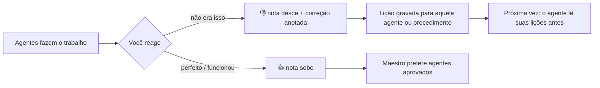
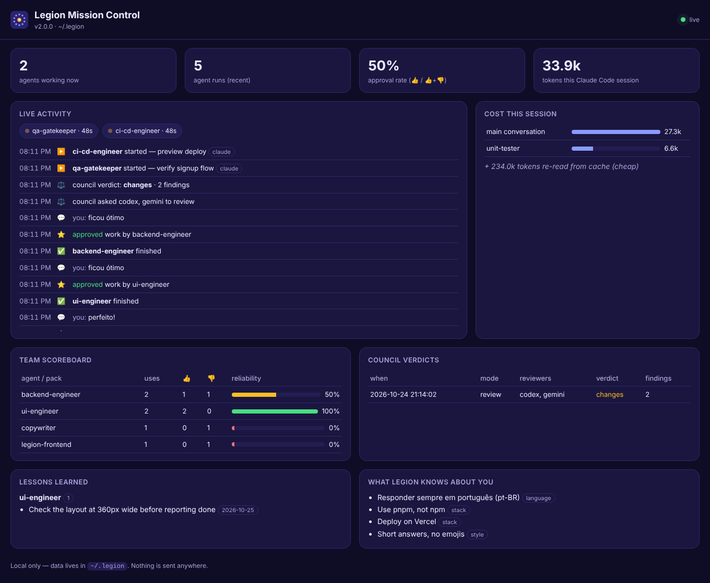

<p align="center">
  
</p>

<h1 align="center">Legion</h1>

<p align="center">
  <b>Um time de IA que divide o trabalho, prova o resultado, é revisado por outras IAs — e aprende o seu jeito.</b><br>
  80 agentes · 300 procedimentos · 10 playbooks · para <b>Claude Code</b>, <b>Codex</b>, <b>Gemini CLI</b> e <b>Cursor</b> · Windows, macOS, Linux
</p>

<p align="center">
  <a href="README.md">🇺🇸 Read in English</a> ·
  <a href="docs/CATALOG.md">Catálogo completo</a> ·
  <a href="#instalação">Instalação</a>
</p>

---

## O que é o Legion?

O Legion transforma seu assistente de programação em uma equipe coordenada. Peça algo grande — *"crie uma página de cadastro com validação e publique"* — e o maestro do Legion divide em subtarefas, coloca os especialistas certos trabalhando **em paralelo**, junta e verifica tudo, e mostra quanto custou.

O que ele tem de diferente:

| | |
|---|---|
| ⚖️ **Conselho de IAs** | Claude, Codex e Gemini **revisam o trabalho um do outro**, só lendo. Um faz, os outros contestam; o autor corrige ou rejeita cada apontamento com justificativa. |
| 📘 **Aprende com o resultado** | Diga "perfeito" ou "não era isso" e o Legion dá nota aos agentes que trabalharam e grava **lições** que eles leem na próxima vez. Ele melhora *para você*. |
| 📡 **Mission Control** | Painel local ao vivo: agentes trabalhando agora, custo por agente, placar do time, lições, vereditos do conselho e memória. |
| ✅ **Sem prova, não está pronto** | Toda tarefa termina com tabela de evidências — o comando, teste ou arquivo que prova cada requisito — e relatório de custo. |
| 🗺️ **Playbooks** | Roteiros de ponta a ponta: MVP de SaaS, produto IoT, app mobile, assistente com RAG, segurança e mais. |
| 🧠 **Memória** | Lembra seu idioma, stack e estilo (`"a partir de agora use pnpm"`) — guardada só no seu computador. |
| 🪶 **Enxuto** | ~9 mil tokens fixos de contexto; modelos baratos para agentes simples; modos solo / lite / full. |

## Instalação

**Windows, macOS ou Linux** — no terminal (PowerShell, Terminal, bash):

```bash
git clone https://github.com/Gleysonp-Dev/legion-ai.git
node legion-ai/install.js
```

O instalador detecta **Claude Code, Codex, Gemini CLI e Cursor** e configura cada um que encontrar. Depois, reinicie-os. Precisa de Node.js 18+ e git.

<details>
<summary>Outras formas de instalar</summary>

**Uma linha (macOS / Linux)**
```bash
curl -fsSL https://raw.githubusercontent.com/Gleysonp-Dev/legion-ai/main/install.sh | sh
```

**Uma linha (Windows PowerShell)**
```powershell
irm https://raw.githubusercontent.com/Gleysonp-Dev/legion-ai/main/install.ps1 | iex
```

**Só no Claude Code, como plugin**
```bash
claude plugin marketplace add Gleysonp-Dev/legion-ai
claude plugin install legion@legion-ai
```

**Escolher ferramentas**: `node install.js --claude --codex --gemini --cursor` (qualquer combinação)
**Ver antes sem mudar nada**: `node install.js --dry-run`
</details>

**Atualizar:** `git -C legion-ai pull && node legion-ai/install.js`
**Desinstalar:** `node legion-ai/install.js --uninstall` (use `--purge` para apagar também memória e lições)

| Ferramenta | Agentes | Skills | Memória e aprendizado | Painel ao vivo |
|---|---|---|---|---|
| Claude Code | subagentes do plugin | skills do plugin | automático (hooks) | atividade completa + custo |
| Codex | `~/.codex/agents` | `~/.agents/skills` | por instruções no `AGENTS.md` | atividade (avisada pelo Legion), custo |
| Gemini CLI | `~/.gemini/agents` | `~/.agents/skills` | por instruções no `GEMINI.md` | atividade (avisada pelo Legion) |
| Cursor | `~/.cursor/agents` | `~/.agents/skills` | automático (hooks) | atividade |

> **App do Claude (modo Cowork):** as skills e agentes do Legion funcionam lá, mas o Cowork roda comandos numa área isolada própria, então o painel, a memória e as lições do seu computador podem não enxergar essa atividade. Para a experiência completa, use o Claude Code (terminal ou aba Code do app).

## Como usar

| Você quer… | Claude Code | Codex / Gemini CLI / Cursor |
|---|---|---|
| Colocar o time numa tarefa grande | `/legion:legion full crie um dashboard SaaS` — ou *"use o legion para…"* | `$legion full …` (Codex) ou *"use a skill legion para…"* |
| Gastar menos | `/legion:legion lite …` | igual, com `lite` |
| Fazer um projeto inteiro | `/legion:legion-playbooks` → *"MVP de SaaS para passeadores de cães"* | *"use legion-playbooks: produto IoT"* |
| Pedir revisão de outras IAs | `/legion:legion-council` ou `node ~/.legion/bin/council.js review` | mesmo comando, com `--host codex` / `gemini` / `cursor` |
| Chamar um especialista | *"use o agente debugger para…"* | Codex: *"chame o debugger"* · Gemini: `@debugger` |
| Acompanhar ao vivo | `node ~/.legion/bin/legion.js dashboard` | igual |
| Ver quanto custou | `node ~/.legion/bin/legion.js report` | `report --codex` no Codex |
| Achar o agente certo | `/legion:legion-help` | `$legion-help` / *"legion-help"* |

## ⚖️ O Conselho de IAs

Modelos de IA diferentes erram coisas diferentes. O conselho faz um pegar o erro do outro:

```bash
cd seu-projeto
node ~/.legion/bin/council.js status --host claude      # quem pode revisar (Codex, Gemini…)
node ~/.legion/bin/council.js review --host claude --focus "o cadastro precisa validar o e-mail"
node ~/.legion/bin/council.js plan docs/plano.md        # contestar um plano antes de construir
node ~/.legion/bin/council.js ask "Postgres ou DynamoDB aqui?"
```

- Os revisores rodam **só lendo** (Codex com `--sandbox read-only`, Claude limitado a Read/Grep/Glob, Gemini sem aprovar ferramentas) e nunca revisam o próprio trabalho.
- Respondem num formato fixo; o Legion junta apontamentos repetidos, ordena por gravidade e calcula um consenso (aprovar / ajustar / rejeitar).
- O autor tem a palavra final: cada apontamento é **corrigido ou rejeitado com justificativa**. Os relatórios ficam em `~/.legion/council/`.
- Usa as IAs que você já tem instaladas e logadas — cada revisão gasta tokens daquela ferramenta.

Exemplo de veredito (execução real, Claude revisando uma mudança feita pelo Codex):

| id | gravidade | onde | problema | apontado por |
|---|---|---|---|---|
| F1 | blocker | app.js:2 | `signup(email)` salva o dado sem nenhuma validação | claude |
| F2 | major | app.js:2 | e-mail não normalizado (espaços/maiúsculas) → contas duplicadas | claude |

## 📘 O Legion aprende com o resultado



- **Placar:** cada agente e pacote recebe 👍/👎 pela sua reação logo depois do trabalho (`legion.js scores`). Entende português, inglês e espanhol.
- **Lições:** depois de uma correção, o maestro grava uma lição prática (`~/.legion/lessons/ui-engineer.md`: *"Conferir o layout em 360px antes de dizer que terminou"*). Aquele agente lê isso em toda tarefa futura.
- **Histórico do time na memória:** o maestro sabe quais agentes já foram aprovados por você e quais precisam de mais atenção.
- As notas são aproximadas (a reação vale para tudo que foi usado naquela rodada); dá para ajustar com `memory.js feedback up|down --target <nome>`.

## 📡 Mission Control

```bash
node ~/.legion/bin/legion.js dashboard              # macOS / Linux / Git Bash
node $HOME\.legion\bin\legion.js dashboard        # Windows PowerShell
npm run dashboard                                   # dentro da pasta legion-ai, qualquer sistema
```

<p align="center"></p>

Uma página local (só 127.0.0.1, nada sai do seu computador) que atualiza ao vivo — alimentada pelos hooks no Claude Code e no Cursor, e pelo próprio Legion (`memory.js event`) no Codex e no Gemini CLI: agentes trabalhando agora, atividade, custo por agente, placar do time, vereditos do conselho, lições e memória.

## 🗺️ Playbooks

| Playbook | O que entrega |
|---|---|
| `saas-mvp` | login, funcionalidade principal, cobrança (modo teste), CI/CD, monitoramento |
| `landing-page-launch` | texto, página rápida, captação de leads, analytics, domínio |
| `iot-product` | firmware, MQTT, banco de séries temporais, painel ao vivo, alertas, OTA |
| `mobile-app` | app com modo offline, push, analytics, publicação nas lojas |
| `api-service` | especificação OpenAPI, endpoints testados, docs, deploy, teste de carga |
| `ai-assistant-rag` | perguntas e respostas sobre seus documentos com fontes, avaliações e proteções |
| `security-hardening` | modelo de ameaças, auditoria, correções, revisão do conselho, reteste |
| `data-dashboard` | definição de métricas, dados limpos, painel confiável |
| `legacy-upgrade` | testes de segurança, atualização passo a passo, rollback |
| `open-source-launch` | histórico limpo, README, CI, licença, posts de lançamento |

Cada um diz quem trabalha em qual etapa, o que cada passo entrega e **o que prova que está pronto**.

## Como funciona uma execução

1. **Memória** — suas preferências, histórico do time e lições são carregados.
2. **Modo** — *solo* (sem agentes), *lite* (até 3) ou *full* (time inteiro): o mais barato que resolve bem.
3. **Plano** — tabela: subtarefa, agente, dependências, onda e como será provado.
4. **Despacho** — subtarefas independentes em paralelo; as dependentes esperam.
5. **Integrar e provar** — o QA roda checagens reais; o conselho revisa o que é importante.
6. **Relatório** — resultado, tabela de evidências, custo.
7. **Aprender** — preferências, notas e lições são atualizadas.

## Os 10 times (80 agentes)

| Time | Agentes |
|---|---|
| **Central de Comando** | conductor, task-splitter, integrator, chief-reviewer, memory-curator, context-scout, qa-gatekeeper, risk-assessor |
| **Arquitetura e Backend** | software-architect, backend-engineer, api-designer, database-architect, microservices-engineer, integration-engineer, realtime-engineer, auth-specialist |
| **Frontend, Mobile e Dispositivos** | frontend-architect, ui-engineer, react-specialist, css-stylist, mobile-engineer, accessibility-expert, web-performance-tuner, iot-engineer |
| **Dados e IA** | data-engineer, data-analyst, ml-engineer, llm-engineer, prompt-engineer, rag-specialist, data-visualizer, analytics-engineer |
| **Infraestrutura e DevOps** | devops-engineer, cloud-architect, ci-cd-engineer, container-specialist, sre-engineer, observability-engineer, cost-optimizer, release-manager |
| **Engenharia de Qualidade** | test-architect, unit-tester, e2e-tester, debugger, code-reviewer, refactoring-expert, performance-engineer, legacy-modernizer |
| **Segurança e Compliance** | security-auditor, appsec-engineer, threat-modeler, secrets-guardian, dependency-auditor, privacy-engineer, compliance-analyst, cloud-security-engineer |
| **Produto e Design** | product-manager, ux-researcher, ux-designer, ui-designer, requirements-analyst, design-system-builder, growth-strategist, roadmap-planner |
| **Conteúdo, Docs e Marketing** | technical-writer, documentation-engineer, copywriter, seo-specialist, content-strategist, translator, social-media-manager, presentation-designer |
| **Negócios, Pesquisa e Operações** | business-analyst, financial-analyst, market-researcher, research-analyst, project-manager, operations-automator, legal-researcher, customer-success-advisor |

Agentes simples rodam no Haiku; os de raciocínio pesado (maestro, arquiteto, revisor-chefe, debugger, auditor de segurança, modelador de ameaças) no Opus; o resto no Sonnet. No Codex isso vira esforço de raciocínio baixo/médio/alto; Gemini CLI e Cursor usam o seu modelo atual. Para forçar um modelo único nos subagentes do Claude Code, use `CLAUDE_CODE_SUBAGENT_MODEL`.

## 300 procedimentos em 30 pacotes

Planejamento · Arquitetura · Frontend · Backend · APIs · Bancos de dados · Testes · Debug · Qualidade de código · Segurança · DevOps · Cloud · Performance · Confiabilidade · Engenharia de dados · Análise de dados · Machine learning · LLMs e agentes · Mobile · Git · Documentação · UX/UI · Produto · Marketing · Escrita · Pesquisa · Negócios e finanças · Produtividade · Jurídico e privacidade · IoT e embarcados

Cada pacote é uma skill (`legion-testing`, `legion-iot`…) com 10 procedimentos lidos só quando precisa — só o índice curto fica no contexto. Veja o [catálogo completo](docs/CATALOG.md).

## Memória, privacidade e comandos

> No Windows PowerShell o `~` não funciona com o `node`: use `$HOME\.legion\bin\legion.js` (ou `npm run dashboard`, `npm run report`, `npm run scores` dentro da pasta legion-ai).

Tudo fica em `~/.legion/` no seu computador: `memory/` (preferências), `lessons/`, relatórios do `council/` e `events.jsonl` (atividade do painel). Senhas, chaves, tokens, números de cartão/conta, CPF e dados de saúde nunca são guardados.

```bash
node ~/.legion/bin/legion.js show                 # o que o Legion sabe sobre você
node ~/.legion/bin/legion.js scores               # placar do time
node ~/.legion/bin/legion.js lessons              # lições aprendidas
node ~/.legion/bin/legion.js report               # tokens desta sessão, por agente
node ~/.legion/bin/legion.js add "Use TypeScript em modo strict"
node ~/.legion/bin/legion.js forget r3
node ~/.legion/bin/memory.js reset --yes          # apaga a memória
```

## Bom saber

- **Custo de contexto:** ~9 mil tokens por sessão no Claude Code (medido com `claude plugin details legion`). Desative por projeto com `claude plugin disable legion@legion-ai --scope local`.
- **Custo do conselho:** cada revisor é uma execução completa daquela IA, na sua conta.
- **Paralelismo no Codex:** aumente o limite em `~/.codex/config.toml` → `[agents] max_concurrent_threads_per_session = 8`.
- **Seus arquivos estão seguros:** o instalador nunca sobrescreve suas skills, agentes, conteúdo do `AGENTS.md`/`GEMINI.md` ou hooks do Cursor; a desinstalação remove só o que o Legion adicionou.
- **Não é aconselhamento profissional:** os agentes jurídicos, financeiros e de compliance produzem rascunhos e análises.

## Contribuindo

Adicione ou melhore agentes, procedimentos e playbooks em `src/`, rode `npm run build && npm test` e abra um pull request. Veja o [CONTRIBUTING.md](CONTRIBUTING.md).

## Licença

[MIT](LICENSE) © 2026 Gleyson
