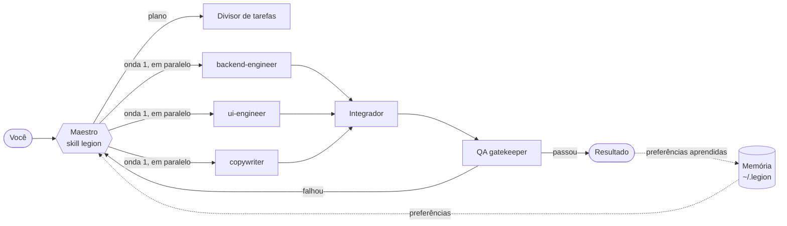

<p align="center">
  
</p>

<h1 align="center">Legion</h1>

<p align="center">
  <b>80 agentes de IA especialistas que dividem o trabalho · 300 procedimentos prontos · prova de cada resultado · uma memória que aprende o seu jeito</b><br>
  Para <b>Claude Code</b> e <b>Codex</b> · Windows, macOS e Linux · dois comandos para instalar
</p>

<p align="center">
  <a href="README.md">🇺🇸 Read in English</a> ·
  <a href="docs/CATALOG.md">Catálogo completo</a> ·
  <a href="#instalação">Instalação</a>
</p>

---

## O que é o Legion?

O Legion transforma seu assistente de programação em uma equipe coordenada. Peça algo grande — *"crie uma landing page com cadastro, testes e deploy"* — e o maestro (conductor) do Legion divide o trabalho em subtarefas, envia cada uma para o especialista certo **em paralelo**, junta os resultados, verifica tudo e lembra do que você gostou para a próxima vez.

**A promessa do Legion: o time prova o que fez e mostra quanto custou.**

| | |
|---|---|
| **80 agentes** | 10 times de 8 especialistas: comando, backend, frontend e dispositivos, dados e IA, infraestrutura, qualidade, segurança, produto e design, conteúdo, negócios |
| **300 procedimentos** | 30 pacotes de skills × 10 procedimentos passo a passo com checklist de qualidade, carregados só quando precisa |
| **Sem prova, não está pronto** | Toda tarefa termina com uma tabela de evidências: o comando, teste ou arquivo que prova cada requisito |
| **Relatório de custo** | Mostra os tokens gastos pela conversa principal e por cada agente — `memory.js report` |
| **Enxuto** | ~9 mil tokens fixos de contexto (60% menos que a v1.0), modelos baratos para agentes simples, modos solo/lite/full |
| **Memória que aprende** | Percebe suas preferências ("sempre responda em português", "use pnpm") e aplica em todas as sessões — guardada só no seu computador |
| **Duas ferramentas** | Claude Code (plugin com agentes, skills e hooks) e Codex (agentes customizados, skills e `AGENTS.md`) |
| **Zero dependências** | Só precisa de Node.js 18+ e git |

## Instalação

**Windows, macOS ou Linux** — no terminal (PowerShell, Terminal, bash):

```bash
git clone https://github.com/Gleysonp-Dev/legion-ai.git
node legion-ai/install.js
```

Pronto. O instalador detecta o Claude Code e/ou o Codex e configura os dois. Depois, reinicie-os.

<details>
<summary>Outras formas de instalar</summary>

**Uma linha (macOS / Linux)**
```bash
curl -fsSL https://raw.githubusercontent.com/Gleysonp-Dev/legion-ai/main/install.sh | sh
```

**Uma linha (Windows PowerShell)**
```powershell
irm https://raw.githubusercontent.com/Gleysonp-Dev/legion-ai/main/install.ps1 | iex
```

**Só no Claude Code, como plugin**
```bash
claude plugin marketplace add Gleysonp-Dev/legion-ai
claude plugin install legion@legion-ai
```

**Só uma ferramenta**: `node install.js --claude` ou `node install.js --codex`
**Ver o que vai acontecer sem mudar nada**: `node install.js --dry-run`
</details>

**Atualizar:** `git -C legion-ai pull && node legion-ai/install.js`
**Desinstalar:** `node legion-ai/install.js --uninstall` (use `--purge` para apagar também a memória)

## Como usar

| Você quer… | Claude Code | Codex |
|---|---|---|
| Colocar o time inteiro numa tarefa grande | `/legion:legion full crie um dashboard SaaS com login e cobrança` — ou só *"use o legion para criar…"* | `$legion full crie um dashboard SaaS com login e cobrança` |
| Gastar menos | `/legion:legion lite …` (no máximo 3 agentes) | `$legion lite …` |
| Chamar um especialista | "use o agente **debugger** para descobrir por que o login falha" | "chame o agente **debugger** para descobrir por que o login falha" |
| Usar um pacote de skills | `/legion:legion-security` ou só descreva a tarefa | `$legion-security` ou só descreva a tarefa |
| Achar o agente/skill certo | `/legion:legion-help` | `$legion-help` |
| Ver o que o Legion aprendeu sobre você | `/legion:legion-memory` | `$legion-memory` |
| Ver quanto uma sessão custou | `node ~/.legion/bin/memory.js report` | `node ~/.legion/bin/memory.js report --codex` |

Os pacotes também são acionados automaticamente quando o seu pedido combina com a descrição deles; o pacote então abre só o procedimento de que precisa.

## Como funciona



1. **Memória** — suas preferências são carregadas no início de cada sessão.
2. **Plano** — o maestro reescreve o objetivo e monta uma tabela: subtarefa, agente, dependências, onda e critérios de aceite.
3. **Despacho** — subtarefas independentes rodam em paralelo; as dependentes esperam.
4. **Integração e prova** — o integrador junta tudo; o QA roda checagens reais (testes, build) e preenche a tabela de evidências. Sem prova, não está pronto.
5. **Relatório** — resultado, evidências e o custo em tokens.
6. **Aprendizado** — novas preferências que você expressou são salvas.

**Modos:** *solo* (sem agentes, para correções rápidas) · *lite* (até 3 agentes) · *full* (time inteiro). O Legion escolhe o modo mais barato que resolve bem, ou você escolhe.

## Os 10 times

| Time | Agentes |
|---|---|
| **Central de Comando** | conductor, task-splitter, integrator, chief-reviewer, memory-curator, context-scout, qa-gatekeeper, risk-assessor |
| **Arquitetura e Backend** | software-architect, backend-engineer, api-designer, database-architect, microservices-engineer, integration-engineer, realtime-engineer, auth-specialist |
| **Frontend, Mobile e Dispositivos** | frontend-architect, ui-engineer, react-specialist, css-stylist, mobile-engineer, accessibility-expert, web-performance-tuner, iot-engineer |
| **Dados e IA** | data-engineer, data-analyst, ml-engineer, llm-engineer, prompt-engineer, rag-specialist, data-visualizer, analytics-engineer |
| **Infraestrutura e DevOps** | devops-engineer, cloud-architect, ci-cd-engineer, container-specialist, sre-engineer, observability-engineer, cost-optimizer, release-manager |
| **Engenharia de Qualidade** | test-architect, unit-tester, e2e-tester, debugger, code-reviewer, refactoring-expert, performance-engineer, legacy-modernizer |
| **Segurança e Compliance** | security-auditor, appsec-engineer, threat-modeler, secrets-guardian, dependency-auditor, privacy-engineer, compliance-analyst, cloud-security-engineer |
| **Produto e Design** | product-manager, ux-researcher, ux-designer, ui-designer, requirements-analyst, design-system-builder, growth-strategist, roadmap-planner |
| **Conteúdo, Docs e Marketing** | technical-writer, documentation-engineer, copywriter, seo-specialist, content-strategist, translator, social-media-manager, presentation-designer |
| **Negócios, Pesquisa e Operações** | business-analyst, financial-analyst, market-researcher, research-analyst, project-manager, operations-automator, legal-researcher, customer-success-advisor |

## 300 procedimentos em 30 pacotes

Planejamento · Arquitetura · Frontend · Backend · APIs · Bancos de dados · Testes · Debug · Qualidade de código · Segurança · DevOps · Cloud · Performance · Confiabilidade · Engenharia de dados · Análise de dados · Machine learning · LLMs e agentes · Mobile · Git · Documentação · UX/UI · Produto · Marketing · Escrita · Pesquisa · Negócios e finanças · Produtividade · Jurídico e privacidade · IoT e embarcados

Cada pacote é uma skill (`legion-testing`, `legion-security`, `legion-iot`…) com 10 procedimentos. Só o índice curto do pacote fica sempre no contexto; o procedimento é lido quando precisa. Cada um tem *quando usar*, passos numerados, checklist de qualidade e saída esperada. Veja o [catálogo completo](docs/CATALOG.md).

## Memória que aprende o seu jeito

O Legion guarda uma memória pequena e legível em `~/.legion/memory/` — **nada é enviado para lugar nenhum**.

- **Explícito** — "lembre que…", "a partir de agora…", "remember that…" → salvo na hora.
- **Implícito** — "sempre…", "nunca…", "prefiro…", "always…" → observado; salvo quando você repete.
- **Idioma** — o Legion percebe em que língua você escreve e responde nela.
- **Hábitos** — registra quais agentes e skills você mais usa.
- **Seguro por padrão** — senhas, chaves, tokens, números de cartão/conta, CPF e dados de saúde nunca são guardados.

```bash
node ~/.legion/bin/memory.js show              # o que o Legion sabe
node ~/.legion/bin/memory.js add "Use TypeScript em modo strict" --category stack
node ~/.legion/bin/memory.js forget r3         # remove uma regra
node ~/.legion/bin/memory.js report            # tokens gastos nesta sessão, por agente
node ~/.legion/bin/memory.js reset --yes       # apaga tudo
```

No Claude Code a memória roda automaticamente via hooks. No Codex ela funciona pelo bloco do Legion que o instalador adiciona em `~/.codex/AGENTS.md`.

## Bom saber

- **Custo de contexto.** Cada skill e agente instalado adiciona uma linha de descrição ao contexto do assistente. O Legion mantém isso em cerca de **9 mil tokens** por sessão no Claude Code (medido com `claude plugin details legion`). Ainda dá para desativar por projeto: `claude plugin disable legion@legion-ai --scope local`.
- **Modelo por agente.** Agentes simples (context-scout, translator, social-media-manager, dependency-auditor) rodam no Haiku; os de raciocínio pesado (conductor, software-architect, chief-reviewer, debugger, security-auditor, threat-modeler) no Opus; o resto no Sonnet. No Codex isso vira esforço de raciocínio baixo/médio/alto. Para forçar um modelo único em todos os subagentes do Claude Code, use a variável `CLAUDE_CODE_SUBAGENT_MODEL`.
- **Paralelismo.** O Claude Code roda vários subagentes ao mesmo tempo. No Codex você pode aumentar o limite em `~/.codex/config.toml`:
  ```toml
  [agents]
  max_concurrent_threads_per_session = 8
  ```
- **Seus arquivos estão seguros.** O instalador nunca sobrescreve skills, agentes ou conteúdo do `AGENTS.md` que você já tinha; a desinstalação remove só o que o Legion adicionou.
- **Não é aconselhamento profissional.** Os agentes jurídicos, financeiros e de compliance produzem rascunhos e análises, não aconselhamento jurídico ou financeiro.

## Contribuindo

Adicione ou melhore agentes e skills em `src/`, rode `npm run build && npm test` e abra um pull request. Veja o [CONTRIBUTING.md](CONTRIBUTING.md).

## Licença

[MIT](LICENSE) © 2026 Gleyson
